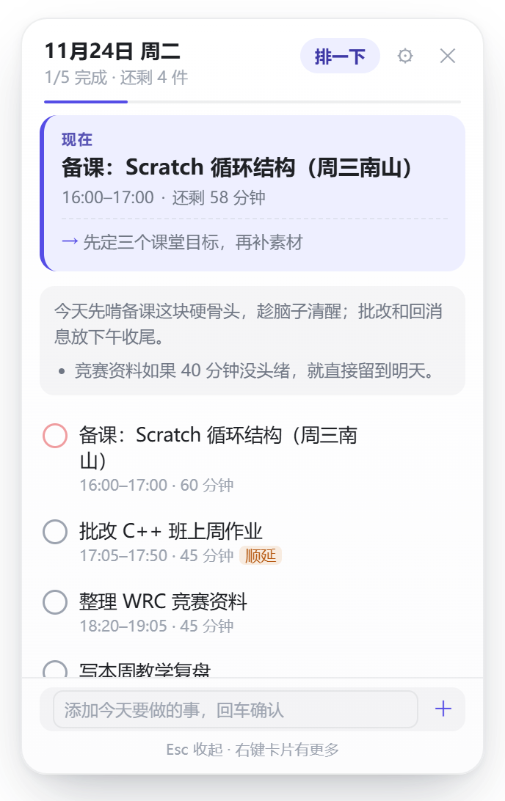
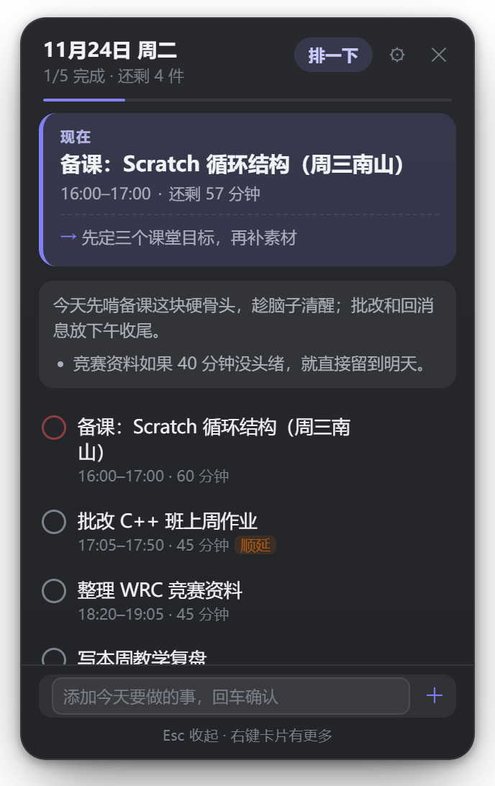

# 今日卡 · TodayCard

> 一张永远待在你桌面角落的今日计划卡。把今天要做的事写上去，它帮你排好先后与时间，到点提醒你从哪一步开始。

不是又一个待办清单。清单解决「记下来」，今日卡解决的是**「记下来了还是不想动」**——所以它只显示今天、只显示当下该做的那一件、并且每件事都带一句能立刻动手的第一步。

<p align="center">
  
  
</p>

## 它解决什么

| 你的问题 | 今日卡的做法 |
| --- | --- |
| 事情一多就乱，不知道先做哪个 | 一键排程：重要的先上，按剩余时间切成时间块 |
| 写下来了但还是拖着不动 | 「现在」卡片只显示一件，带倒计时和第一步动作 |
| 忘了时间、一抬头半天没了 | 到点弹系统通知，每块开始提醒一次 |
| 昨天的没做完，今天就消失了 | 未完成自动顺延到今天，并标注「顺延」来源 |
| 待办软件太重、开着还用不上 | 常驻桌面角落，开机自启，全程零点击查看 |

## 特点

- **轻**：运行时零第三方依赖，界面是原生 HTML/CSS/JS，没有 React、没有打包器。空闲时每分钟只唤醒一次做时间校准，CPU 占用接近于零。
- **不联网也能用**：AI 排程是可选项。没配 Key、断网、模型抽风时自动回落到内置规则排程，功能不残缺。
- **AI 结果不会乱来**：模型返回的 JSON 会经过一层确定性清洗——不存在的任务丢弃、越界时间夹回、重叠的块推开、漏排的自动补位。排得不好可以重排，不会把计划搞坏。
- **数据在你自己机器上**：单个 JSON 文件，明文可读、可备份、可手改。API Key 用系统 DPAPI 加密（Windows），换台机器拷走文件也解不开。

## 快速开始

```bash
git clone <你的仓库地址> todaycard
cd todaycard
npm install
npm run icons     # 生成图标（仓库里没有二进制图标，由脚本画出来）
npm start
```

打包安装包（Windows 上产出 NSIS 安装版 + 免安装版）：

```bash
npm run dist:win
```

产物在 `dist/`。安装版的 `createDesktopShortcut`、开机自启都是已配好的。

## 用起来

| 操作 | 说明 |
| --- | --- |
| 底部输入框回车 | 添加一件事，默认时长取设置里的「单件事默认时长」 |
| 双击标题 | 改标题 |
| 拖拽行 | 调整顺序 |
| ☆ / ★ | 标记重要，排程时会优先安排 |
| 右上「排一下」 | 按当前剩余时间重排今天 |
| 拖动卡片 / 头部 | 移动位置，退出后记住 |
| `Ctrl + Alt + T` | 全局唤出（可在设置里改） |
| `Esc` | 收进托盘 |
| 右键卡片 | 置顶 / 重排 / 设置 / 退出 |
| `/` | 聚焦输入框 |

| 收起窗口不退出 | 点 ✕ 只是收进托盘，程序还在，托盘菜单里才能真退出 |
| 开机自启 | 在「启动」文件夹放一个快捷方式；不想要了就在设置里关掉，或直接删掉那个快捷方式 |

收起窗口不退出程序，托盘图标常驻。要真正退出走托盘菜单或右键菜单。

## 配置 AI 排程

设置 → AI 排程，填三样：接口地址、模型名、API Key。所有服务商都走 OpenAI 兼容协议，换一家只改这三项：

| 服务商 | 接口地址 | 常用模型 |
| --- | --- | --- |
| DeepSeek | `https://api.deepseek.com/v1` | `deepseek-chat` |
| 通义千问 | `https://dashscope.aliyuncs.com/compatible-mode/v1` | `qwen-plus` |
| 月之暗面 | `https://api.moonshot.cn/v1` | `moonshot-v1-8k` |
| 智谱 GLM | `https://open.bigmodel.cn/api/paas/v4` | `glm-4-flash` |
| OpenAI | `https://api.openai.com/v1` | `gpt-4o-mini` |
| 本地 Ollama | `http://127.0.0.1:11434/v1` | `qwen2.5:7b` |

填完点「测试连接」确认三件套都对，再「保存」。

不填也能用——关掉「用 AI 帮我排」，排程走内置规则：按优先级和耗时排序，从当前时间往后铺，自动跳过午休、留出块间缓冲、超出收工时间就标为今天做不完。

## 数据与隐私

| 项目 | 位置 |
| --- | --- |
| 数据文件 | Windows：`%APPDATA%\TodayCard\data.json` |
| 设置里的「数据文件夹」 | 一键打开上面这个目录 |
| API Key | 存在 `data.json` 的 `ai.apiKeyEnc`，DPAPI 加密，绑定当前 Windows 账户 |

- 除了你主动点击「排一下」且开启 AI 时，程序**不发任何网络请求**。
- 发出去的只有：任务标题、优先级、预计时长、备注，以及你的时间区间设置。不发历史记录、不发设备信息。
- 数据文件损坏时不会静默清空，会先备份成 `data.json.corrupt-<时间戳>` 再重建。

## 开发

```bash
npm test          # 43 项单测：排程边界、AI 结果清洗、存储迁移、跨天顺延
npm run dev       # 带 DevTools 启动
npm run lint      # 语法检查
```

目录结构：

```
src/
  main/           主进程（Node 侧，全部逻辑在这）
    main.js       窗口/托盘/快捷键/IPC/定时推送
    store.js      JSON 持久化，防抖 + 原子写
    planner.js    规则排程 + AI 结果清洗（核心算法）
    ai.js         OpenAI 兼容客户端，零 SDK
    secret.js     API Key 的 DPAPI 加解密
    defaults.js   默认设置、任务模型、服务商预设
    datetime.js   时间工具（纯函数）
  preload/        白名单 IPC 桥
  renderer/       界面（原生 HTML/CSS/JS）
scripts/
  gen-icons.js    图标生成（纯 Node 画 PNG/ICO）
test/             单测
docs/             架构说明
```

更多设计取舍见 [docs/ARCHITECTURE.md](docs/ARCHITECTURE.md)。

## 已知限制

- 窗口固定尺寸（344×546），不支持自由缩放——桌面挂件不该被误拖动改形状，列表内部滚动。
- 到点提醒依赖系统通知权限；Windows 专注助手开启时可能被折叠。
- 「顺延」最多带 10 条，防止旧账堆成山；更早的未完成任务留在原日期，不主动清理。
- 目前只做了中文界面。

## License

[MIT](LICENSE)
